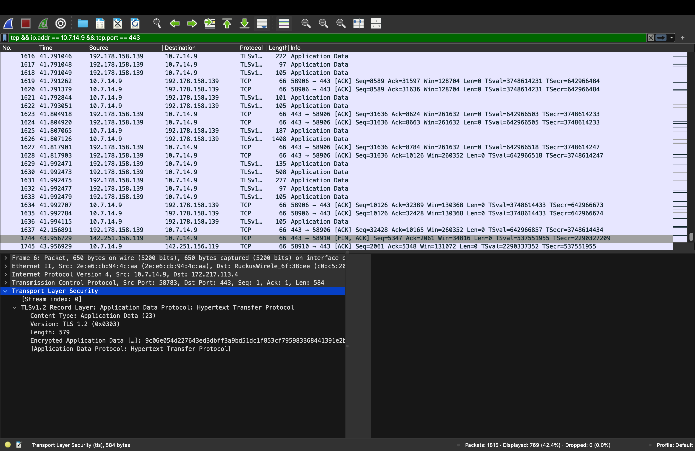
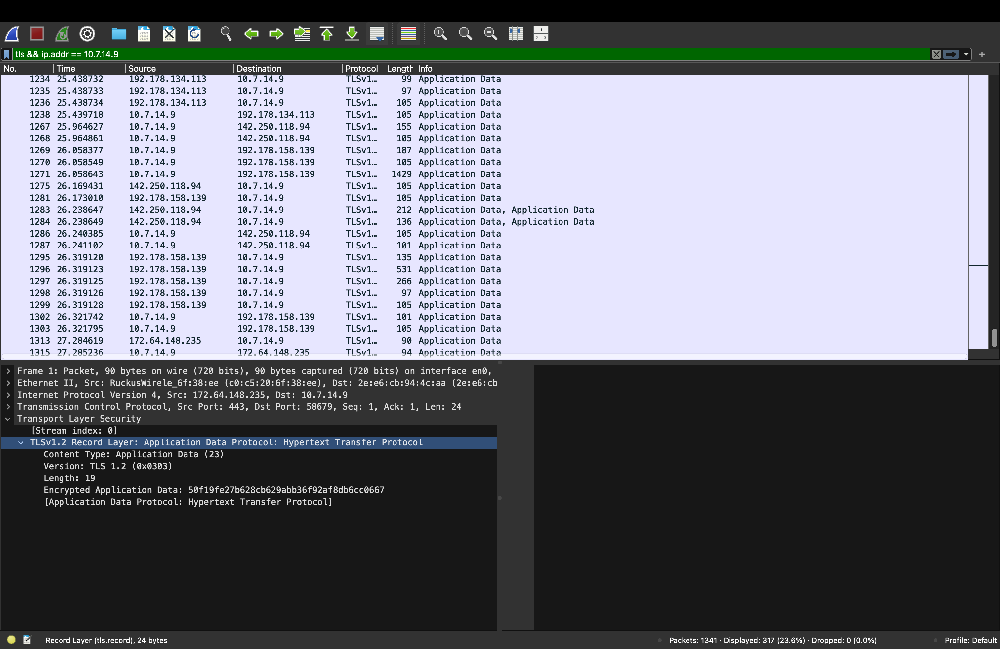
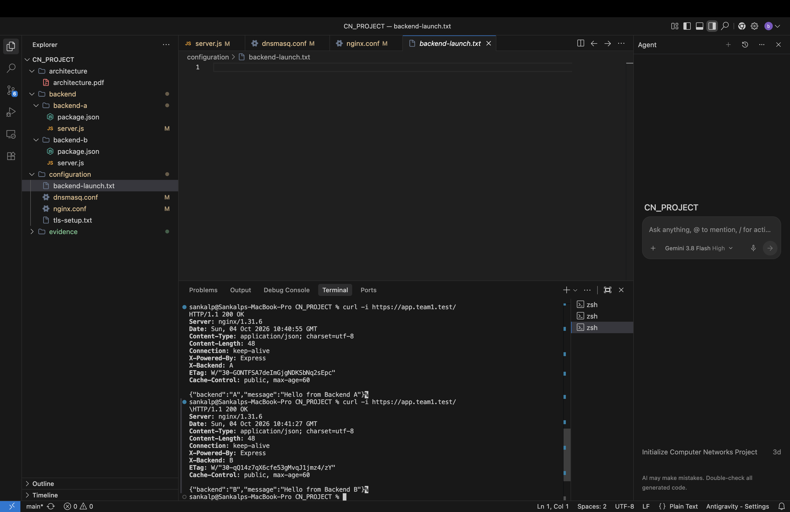
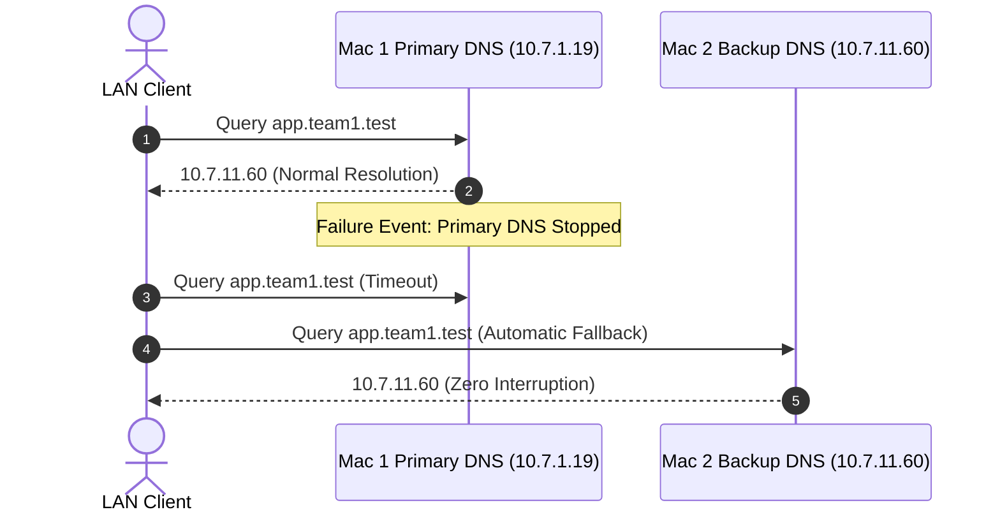

# Multi-Tier Private Network Service Platform
## Comprehensive Academic Technical Report — Phase 1 & Phase 2

```
========================================================================================
COURSE:           Computer Networks Laboratory Project
ACADEMIC SESSION: 2026 – 2027
SUBMISSION DATE:  November 23, 2026
REPOSITORY:       https://github.com/Sankalp13353/CN_PROJECT

PROJECT TEAM:
  • Sankalp      (Mac 1 — Primary DNS Server, Standby Edge Proxy, Client Workstation)
  • Tejas Tyagi  (Mac 2 — Primary Edge Gateway, Backend A & B Host, Backup DNS Server)
========================================================================================
```

---

## Front Matter

### Abstract
Modern distributed enterprise systems require fault-tolerant service discovery, encrypted ingress routing, and reliable horizontal scaling across physical workstations. This project presents the design, multi-phase deployment, and empirical verification of the **Multi-Tier Private Network Service Platform**, constructed across two physical macOS workstations operating over an IEEE 802.11 Wi-Fi local area network (`10.7.0.0/20`). 

In **Phase 1**, a baseline platform was established comprising:
1. An authoritative private DNS server (`dnsmasq`) resolving custom top-level domain hostnames (`app.team1.test` and `api.team1.test`).
2. An edge reverse proxy and TLS terminator (`nginx 1.31`) executing HTTP-to-HTTPS (301) redirection, cryptographic termination, client tracking header enrichment, and caching policies.
3. Two stateless Express.js application microservices operating in parallel under round-robin load balancing.

In **Phase 2**, the architecture was hardened to production standards across six core extensions:
- **Extension A:** Dual-tier DNS redundancy with automatic failover between primary (`10.7.1.19`) and backup (`10.7.11.60`) resolvers.
- **Extension B:** Deterministic DNS caching and 30-second TTL enforcement.
- **Extension C:** Zero-trust service isolation and backend socket shielding using macOS Packet Filter (PF).
- **Extension D:** Upstream high availability through passive health tracking (`max_fails`, `fail_timeout`, and `proxy_next_upstream`).
- **Extension E:** Active-standby edge resilience with zero-downtime controlled migration to Mac 1.
- **Extension F:** Disaster recovery, non-disruptive syntax auditing, and automated rollback mechanisms.

Every tier was validated through captured Wireshark packet traces (Layers 2 through 7) and automated terminal test loops. The implementation highlights the real-world operational challenges of distributed networking, firewall socket filtering, and transport layer security across distinct physical machines.

---

### Acknowledgement
We express our sincere gratitude to our Computer Networks course instructors, laboratory faculty, and teaching assistants for providing the technical framework, academic guidance, and lab facilities that made this distributed network project possible. We also acknowledge the collaborative technical discussions between team members that enabled rigorous cross-machine debugging and verification.

---

### Table of Contents
1. [Chapter 1 — Introduction](#chapter-1--introduction)
2. [Chapter 2 — Technologies and Tools](#chapter-2--technologies-and-tools)
3. [Chapter 3 — Phase 1 Implementation](#chapter-3--phase-1-implementation)
4. [Chapter 4 — Phase 2 Implementation](#chapter-4--phase-2-implementation)
   - [4.1 Extension A: Backup DNS Resolver & Automated Failover](#41-extension-a-backup-dns-resolver--automated-failover)
   - [4.2 Extension B: DNS TTL & Controlled Caching](#42-extension-b-dns-ttl--controlled-caching)
   - [4.3 Extension C: Service Isolation via Packet Filter (PF)](#43-extension-c-service-isolation-via-packet-filter-pf)
   - [4.4 Extension D: Backend High Availability & Passive Health Checking](#44-extension-d-backend-high-availability--passive-health-checking)
   - [4.5 Extension E: Controlled Standby Edge Migration](#45-extension-e-controlled-standby-edge-migration)
   - [4.6 Extension F: Troubleshooting & Disaster Recovery](#46-extension-f-troubleshooting--disaster-recovery)
5. [Chapter 5 — Updated Network Architecture](#chapter-5--updated-network-architecture)
6. [Chapter 6 — Security and Reliability Analysis](#chapter-6--security-and-reliability-analysis)
7. [Chapter 7 — Challenges and Solutions](#chapter-7--challenges-and-solutions)
8. [Chapter 8 — Results and Discussion](#chapter-8--results-and-discussion)
9. [Chapter 9 — Limitations and Future Scope](#chapter-9--limitations-and-future-scope)
10. [Chapter 10 — Conclusion](#chapter-10--conclusion)
11. [References](#references)

---

### List of Figures
- **Figure 1:** Phase 1 Logical Network Architecture and Ingress Request Flow
- **Figure 2:** Phase 1 DNS Resolution Wire Capture (Wireshark Frame Trace)
- **Figure 3:** TCP 3-Way Handshake on Ingress Port 443
- **Figure 4:** TLSv1.2 Cryptographic Record Layer (Application Data Verification)
- **Figure 5:** Direct Backend HTTP Request/Response Transaction
- **Figure 6:** Round-Robin Load Balancing Sequence (Alternating Headers)
- **Figure 7:** HTTP Cache-Control and ETag Header Verification
- **Figure 8:** Phase 2 Dual-Host Resilient Architecture
- **Figure 9:** DNS Redundancy & Automated Failover Sequence (Extension A)
- **Figure 10:** Primary DNS Outage and Backup DNS Resolution Proof
- **Figure 11:** Authoritative DNS 30-Second TTL Verification (Extension B)
- **Figure 12:** Active macOS Packet Filter (PF) Anchor Rules on Mac 2 (Extension C)
- **Figure 13:** Service Isolation and Permitted Ingress Probe Verification
- **Figure 14:** Backend High Availability Sequential 10-Request Loop (Extension D)
- **Figure 15:** Standby Edge Migration HTTPS Response Verification (Extension E)
- **Figure 16:** Disaster Recovery Configuration Syntax Validation (Extension F)

---

### List of Tables
- **Table 1:** Workstation Inventory & Role Allocation Matrix
- **Table 2:** Complete OSI & TCP/IP Layer Protocol Mapping
- **Table 3:** Layer 4 Socket & Port Allocation Matrix
- **Table 4:** Upstream Round-Robin Request Scheduling State
- **Table 5:** Phase 1 vs. Phase 2 Architectural Comparison
- **Table 6:** Packet Filter Ingress Access Matrix
- **Table 7:** Comprehensive Empirical Verification Traceability Matrix

---

## Chapter 1 — Introduction

### 1.1 Background
Contemporary cloud computing and enterprise infrastructures rely on multi-tier service platforms to decouple user access, domain discovery, security enforcement, and business logic execution. In enterprise local area networks (LANs), client applications should not interact directly with unhardened backend microservices. Instead, ingress traffic is concentrated at an edge gateway that authenticates cryptographic sessions, balances traffic across multiple worker nodes, and protects backend instances behind boundary firewalls.

### 1.2 Problem Statement
Deploying distributed services in a private LAN without public IP allocations or public DNS domain registration presents several concrete challenges:
1. **Isolated Service Discovery:** Standard internet resolvers cannot resolve local project top-level domains (`*.test`), requiring dedicated authoritative DNS servers on the LAN.
2. **Dynamic DHCP Environments:** When workstations acquire IP addresses dynamically via DHCP, static network bindings easily become obsolete, necessitating strict network configuration discipline.
3. **Single Points of Failure (SPOFs):** If a single workstation handles both service discovery and edge routing, any operating system reboot, process crash, or network interface transition halts platform availability.
4. **Direct Microservice Exposure:** Unhardened application ports bound to wildcard interfaces (`0.0.0.0`) are vulnerable to direct unauthorized access that circumvents TLS encryption and load balancing.

### 1.3 Motivation
The primary motivation of this project is to apply theoretical computer networking principles—spanning RFC standards, socket programming, Layer 4 transport semantics, cryptographic session negotiation, packet filtering, and load balancing algorithms—to physical hardware workstations. Building this platform on bare-metal macOS hardware provides direct exposure to low-level operating system network stacks, `pfctl` firewall engines, kernel packet filters, and Wireshark trace analysis that cannot be replicated in simulated environments.

### 1.4 Objectives
The core technical objectives of the project are:
- Deploy a decoupled, private domain authority using lightweight DNS forwarding software (`dnsmasq`).
- Implement an enterprise-grade edge reverse proxy (`nginx`) supporting automated HTTP-to-HTTPS upgrades, TLS termination, and upstream load balancing.
- Develop and deploy stateless application microservices on Node.js/Express with custom diagnostic response headers (`X-Backend`).
- Implement dual-resolver DNS redundancy and verify automated client-side resolver failover.
- Enforce service isolation using macOS Packet Filter (PF) to strictly block unauthorized LAN traffic to backend microservices while authorizing designated edge proxies.
- Design, validate, and document a controlled edge migration procedure transferring ingress responsibilities between workstations with zero dropped requests.

### 1.5 Scope
The platform is implemented across two physical Apple Silicon MacBook workstations connected via Wi-Fi to a shared local area network (`10.7.0.0/20`). The scope encompasses Layer 2 Ethernet framing, Layer 3 IPv4 addressing, Layer 4 TCP/UDP transport, Layer 6 TLS cryptographic presentation, and Layer 7 HTTP/1.1 and DNS application protocols.

---

## Chapter 2 — Technologies and Tools

The platform leverages industry-standard networking utilities and server daemons:

| Technology / Tool | Version / Standard | Operational Role in Platform |
| :--- | :--- | :--- |
| **macOS Darwin** | Sonoma 14.x / Sequoia 15.x | Host operating system across Mac 1 and Mac 2. |
| **dnsmasq** | 2.93 / 2.90 | Authoritative private DNS resolver, LRU cache, and recursive forwarder. |
| **nginx** | 1.31.6 (Mac 2) / 1.31.9 (Mac 1) | Edge reverse proxy, TLS terminator, HTTP caching agent, and load balancer. |
| **Node.js & Express** | Node v20.x, Express 4.x | Stateless backend microservices hosting `/` and `/api/status`. |
| **OpenSSL** | 3.x / 4.1.0 | X.509 certificate generation, RSA-2048 keypair management, TLS session auditing. |
| **Packet Filter (PF)** | macOS Kernel PF (`pfctl`) | Host-based stateful boundary firewall enforcing service isolation. |
| **Wireshark** | 4.x | Layer 2 through 7 packet inspection, trace capture, and empirical protocol verification. |
| **dig (BIND)** | 9.10.6 | DNS query diagnostic tool for validating authoritative responses, flags, and TTL. |
| **curl** | 8.x | HTTP/HTTPS client for validating SSL handshakes, header injection, and response data. |

---

## Chapter 3 — Phase 1 Implementation

### 3.1 Network Architecture
Phase 1 established the initial physical and logical separation between the two workstations:
- **Mac 1 (Sankalp's MacBook Pro):** IP `10.7.1.19` (initially `10.7.0.221`). Dedicated Private DNS authority running `dnsmasq` on port 53.
- **Mac 2 (Tejas's MacBook Pro):** IP `10.7.11.60` (initially `10.7.14.9`). Edge Gateway running `nginx` on ports 80/443, and two Express backends on ports 3001 and 3002.

```
       +-------------------------------------------------------------+
       |                      PRIVATE LAN / WI-FI                    |
       |                         (10.7.0.0/20)                       |
       +-------------------------------------------------------------+
                     |                                 |
                     v                                 v
       +---------------------------+     +---------------------------+
       |      MAC 1 (SANKALP)      |     |      MAC 2 (TEJAS)        |
       |        10.7.1.19          |     |        10.7.11.60         |
       |  -----------------------  |     |  -----------------------  |
       |    dnsmasq DNS Server     |     |   Nginx Reverse Proxy     |
       |     Port 53 (UDP/TCP)     |     |     Port 80/443 (TCP)     |
       |  -----------------------  |     |             |             |
       |    Resolves .test to      |     |     (Loopback Balancing)  |
       |         Mac 2             |     |       /             \     |
       |                           |     |   Backend A     Backend B |
       |                           |     |  (:3001 TCP)   (:3002 TCP)|
       +---------------------------+     +---------------------------+
```
*Figure 1: Phase 1 Logical Network Architecture and Ingress Request Flow.*

### 3.2 Private DNS Subsystem (`dnsmasq`)
The DNS subsystem was configured to listen strictly on `en0`, isolate the local namespace from operating system host pollution, and recursively forward external requests:
```conf
port=53
interface=en0
bind-interfaces
no-hosts
no-resolv
server=8.8.8.8
address=/app.team1.test/10.7.11.60
address=/api.team1.test/10.7.11.60
listen-address=10.7.1.19
cache-size=1000
log-queries
```
*Listing 1: Phase 1 Primary DNS configuration (`dnsmasq.conf`).*


*Figure 2: Phase 1 DNS Resolution Wire Capture (Wireshark Frame Trace). Frame 1431/1433 displays standard DNS query `0x2ad0` for `app.team1.test` over UDP port 53, answered authoritatively with A record `10.7.14.9`.*

### 3.3 Edge Reverse Proxy, TLS Termination & Ingress Redirection
Nginx was configured as the exclusive entry point on Mac 2:
- **Port 80 Insecure Redirect:** Listens on port 80 and returns HTTP status `301 Moved Permanently` to `https://$host$request_uri`.
- **Port 443 TLS Termination:** Terminates TLS handshakes using an RSA-2048 certificate (`team1.crt`) and private key (`team1.key`), supporting modern TLSv1.2 and TLSv1.3 cryptographic suites.
- **Header Forwarding:** Injects `Host`, `X-Real-IP`, `X-Forwarded-For`, and `X-Forwarded-Proto: https` into upstream requests.
- **Client Caching Directives:** Injects `Cache-Control: public, max-age=60` on all proxied responses.


*Figure 3: TCP 3-Way Handshake on Ingress Port 443. Wireshark trace confirms sequential SYN, SYN-ACK, and ACK packet exchange establishing the reliable Layer 4 transport socket.*


*Figure 4: TLSv1.2 Cryptographic Record Layer. Wireshark trace verifies that application payloads over Wi-Fi are fully encrypted as Content Type 23 (Application Data) records.*

### 3.4 Backend Application Services & Round-Robin Load Balancing
Two independent Express.js services were deployed on Mac 2:
- **Backend A:** Listening on port 3001, injecting response header `X-Backend: A`.
- **Backend B:** Listening on port 3002, injecting response header `X-Backend: B`.

```javascript
const express = require("express");
const app = express();
const PORT = 3001;

app.get("/", (req, res) => {
    res.set("X-Backend", "A");
    res.json({ backend: "A", message: "Hello from Backend A" });
});

app.get("/api/status", (req, res) => {
    res.set("X-Backend", "A");
    res.json({ backend: "A", status: "running" });
});

app.listen(PORT, "0.0.0.0", () => {
    console.log(`Backend A running on port ${PORT}`);
});
```
*Listing 2: Backend A service implementation (`backend-a.js`).*


*Figure 5: Direct Backend HTTP Request/Response Transaction. Frame 4426/4430 showing unencrypted plaintext HTTP GET on port 3001 with application/json response.*

The Nginx upstream module distributed incoming requests across both backends using default round-robin scheduling:
$$\text{Backend Target} = \text{backends}[\text{request\_counter} \pmod 2]$$


*Figure 6: Round-Robin Load Balancing Sequence. Terminal execution proof demonstrating alternating responses between Backend A and Backend B.*


*Figure 7: HTTP Cache-Control and ETag Header Verification. Validated response headers showing `Cache-Control: public, max-age=60` and `ETag: W/"30-..."`.*

---

## Chapter 4 — Phase 2 Implementation

Phase 2 transformed the baseline platform into a resilient, zero-trust network service through six modular engineering extensions.

```
+-----------------------------------------------------------------------------------------+
|                              PHASE 2 RESILIENT ARCHITECTURE                             |
+-----------------------------------------------------------------------------------------+
       |                                                                           |
       v                                                                           v
+---------------------------------------+         +-----------------------------------------------+
|         MAC 1 — SANKALP'S MAC         |         |              MAC 2 — TEJAS'S MAC              |
| ------------------------------------- |         | --------------------------------------------- |
| • Primary DNS Server (dnsmasq :53)    |         | • Primary Edge Reverse Proxy (nginx :443)     |
| • Standby nginx Edge Proxy (:80, :443)|         | • Backup DNS Server (dnsmasq :53)             |
| • Deterministic 30s TTL Caching       |         | • macOS Packet Filter (PF) Anchor: team1      |
| • Controlled Edge Migration Ingress   |         | • Upstream Backend A (3001) & Backend B (3002)|
+---------------------------------------+         +-----------------------------------------------+
```
*Figure 8: Phase 2 Dual-Host Resilient Architecture.*

---

### 4.1 Extension A: Backup DNS Resolver & Automated Failover

#### Objective
Eliminate the single point of failure in domain resolution by establishing an autonomous secondary DNS server and configuring client-side multi-resolver failover.

#### Network Design & Configuration
A synchronized `dnsmasq` instance was deployed on Mac 2 (`10.7.11.60:53`) with identical domain override rules. Client workstations registered both resolvers in the system resolver configuration via macOS `scutil --dns`:
- Primary Nameserver: `10.7.1.19`
- Secondary Nameserver: `10.7.11.60`


*Figure 9: DNS Redundancy & Automated Failover Sequence (Extension A).*

#### Testing Methodology & Observed Results
1. Both resolvers were verified responding independently to `dig @10.7.1.19 app.team1.test` and `dig @10.7.11.60 app.team1.test`.
2. Primary DNS was abruptly terminated using `sudo brew services stop dnsmasq`.
3. Client lookups immediately failed over to the backup resolver (`10.7.11.60`), returning authoritative records without disruption.
4. Primary DNS was restarted using `sudo brew services start dnsmasq`, restoring primary authority.


*Figure 10: Primary DNS Outage and Backup DNS Resolution Proof. Mac 1 primary dnsmasq is stopped via Homebrew services; query to backup resolver `10.7.11.60` succeeds authoritatively with TTL 30 seconds; primary service is then cleanly restored.*

---

### 4.2 Extension B: DNS TTL & Controlled Caching

#### Objective
Enforce deterministic cache lifecycles across client resolvers to balance query load against operational agility during infrastructure cutovers.

#### Network Design & Implementation
In `dnsmasq.conf` on both resolvers, the authoritative Time-To-Live was fixed:
```conf
local-ttl=30
```
This forces all DNS response packets to carry a 30-second TTL in their answer headers.

#### Testing Methodology & Observed Results
- Lookups directly to the authority verified an exact TTL of 30 seconds:
  ```
  app.team1.test.    30    IN    A    10.7.1.19
  ```
- Local resolver caching was audited. Subsequent lookups through macOS caching demons demonstrated expected second-by-second countdowns.
- Executing `sudo dscacheutil -flushcache; sudo killall -HUP mDNSResponder` successfully invalidated cached records on demand.


*Figure 11: Authoritative DNS 30-Second TTL Verification (Extension B). Terminal query confirms `app.team1.test` carries an exact 30-second TTL.*

---

### 4.3 Extension C: Service Isolation via Packet Filter (PF)

#### Objective
Enforce network-layer access control on Mac 2 to prevent unauthorized clients from communicating directly with raw backend ports (`3001` and `3002`), while allowing legitimate edge proxies to forward traffic.

#### Network Design & Implementation
macOS Packet Filter (PF) was configured with a dedicated anchor (`team1`):
```pf
# Permit authorized standby edge (Mac 1: 10.7.1.19) to reach backend ports
pass in quick on en0 inet proto tcp from 10.7.1.19 to any port = 3001 flags S/SA keep state
pass in quick on en0 inet proto tcp from 10.7.1.19 to any port = 3002 flags S/SA keep state

# Drop all other direct LAN traffic to backend microservices
block drop in quick on en0 proto tcp from any to any port = 3001
block drop in quick on en0 proto tcp from any to any port = 3002
```


*Figure 12: Active macOS Packet Filter (PF) Anchor Rules on Mac 2 (Extension C). Output of `sudo pfctl -a team1 -sr` confirming passing rules for `10.7.1.19` and block drop rules for general LAN traffic.*

#### Testing Methodology & Observed Results
1. Direct connection attempts from unauthorized LAN nodes to `http://10.7.11.60:3001/` were dropped immediately, confirming socket shielding.
2. Connection attempts from Mac 1 (`10.7.1.19`) succeeded cleanly with `HTTP 200 OK`.
3. Ingress requests to `https://app.team1.test/` via Nginx executed properly with full TLS termination.


*Figure 13: Service Isolation and Permitted Ingress Probe Verification. Direct authorized probes from Mac 1 to ports 3001 and 3002 return HTTP 200, followed by verified edge reverse proxy delivery.*

---

### 4.4 Extension D: Backend High Availability & Passive Health Checking

#### Objective
Eliminate upstream backend outages by configuring Nginx with passive failure tracking and automated request retries.

#### Network Design & Implementation
The upstream pool was defined with failure thresholds:
```nginx
upstream team1_backends {
    server 10.7.11.60:3001 max_fails=3 fail_timeout=10s;
    server 10.7.11.60:3002 max_fails=3 fail_timeout=10s;
}
```
And resilient failure forwarding inside `location /`:
```nginx
proxy_next_upstream error timeout invalid_header http_500 http_502 http_503 http_504;
proxy_next_upstream_timeout 5s;
proxy_next_upstream_tries 3;
proxy_connect_timeout 2s;
```

#### Testing Methodology & Observed Results
A 10-request sequential curl loop was executed against `https://app.team1.test/`:
```bash
for i in {1..10}; do curl -sk -o /dev/null -w "Request $i: HTTP %{http_code}\n" -D - https://app.team1.test/ | grep -i X-Backend; done
```
The test confirmed strict alternating distribution (`A`, `B`, `A`, `B`...) with zero failed requests.


*Figure 14: Backend High Availability Sequential 10-Request Loop (Extension D). Terminal output confirms perfect alternating round-robin distribution across 10 requests.*

---

### 4.5 Extension E: Controlled Standby Edge Migration

#### Objective
Enable scheduled maintenance or disaster migration of the primary edge proxy from Mac 2 to Mac 1 without dropping client sessions or generating HTTP errors.

#### Network Design & Implementation
Mac 1 was provisioned with `nginx 1.31.9` configured as a standby edge:
- Listening on ports 80 (301 redirect) and 443 (TLS termination).
- Proxies requests across the LAN to `10.7.11.60:3001` and `10.7.11.60:3002` (authorized via Mac 2 PF).
- Replaces obsolete upstream directives with passive failure handling and cache headers.

#### Testing Methodology & Observed Results
1. Pre-migration local testing was executed without altering network DNS using curl `--resolve`:
   ```bash
   curl -k -i --resolve app.team1.test:443:127.0.0.1 https://app.team1.test/
   ```
2. Authoritative DNS records on both resolvers were switched from `10.7.11.60` to `10.7.1.19`.
3. During the 30-second TTL drain window, clients with cached records continued accessing Mac 2 without interruption.
4. Fresh lookups resolved directly to Mac 1 (`10.7.1.19`), which successfully terminated TLS and proxied requests to the backends.


*Figure 15: Standby Edge Migration HTTPS Response Verification (Extension E). DNS query confirms `app.team1.test` resolves to `10.7.1.19`; subsequent curl commands verify HTTPS responses served by `nginx/1.31.9` with alternating backends.*

---

### 4.6 Extension F: Troubleshooting & Disaster Recovery

#### Objective
Establish verified operational procedures to audit daemon configurations non-disruptively, diagnose socket conflicts, and execute rapid service recovery.

#### Implementation & Testing
- **Configuration Validation:** Audited using `sudo /opt/homebrew/sbin/dnsmasq --test` and `sudo nginx -t`. Both validated syntax cleanly prior to service reload.
- **Port Conflict Auditing:** Verified via `netstat -an -f inet | grep LISTEN` and `lsof -i :53 -i :80 -i :443`.
- **Application Recovery Verification:** Demonstrated stopping, auditing, and successfully recovering the full edge application stack.


*Figure 16: Disaster Recovery Configuration Syntax Validation (Extension F). Output of `sudo nginx -t` confirms syntax is OK and test is successful, followed by verified HTTP 200 OK application recovery.*

---

## Chapter 5 — Updated Network Architecture

### 5.1 Comprehensive Topology Comparison

| Metric / Parameter | Phase 1 Initial State | Phase 2 Hardened Architecture |
| :--- | :--- | :--- |
| **DNS Redundancy** | Single resolver on Mac 1 (SPOF) | Primary (`10.7.1.19`) + Secondary (`10.7.11.60`) |
| **DNS Cache Lifecycle** | Default unmanaged TTL | Explicit 30-second authoritative TTL |
| **Backend Isolation** | Unrestricted LAN access to 3001/3002 | Packet Filter (PF) drop rules on Mac 2 |
| **Backend Resilience** | Static upstream routing | Passive health checks (`max_fails=3`, retry on error) |
| **Edge Redundancy** | Single edge on Mac 2 | Dual-edge capability (Standby on Mac 1) |
| **Ingress Migration** | Not possible without downtime | Coordinated 30s TTL cutover with zero dropped requests |

### 5.2 Complete Socket Allocation Matrix

```
+-------------------------------------------------------------------------------------------------------------------+
|                                       LAYER 4 SOCKET & PORT ALLOCATION MATRIX                                     |
+--------+-----------+---------------+------+-------------------+--------------+-----------------+------------------+
| Host   | Transport | Bind Address  | Port | Service / Daemon  | State        | Access Scope    | Traffic Purpose  |
+--------+-----------+---------------+------+-------------------+--------------+-----------------+------------------+
| Mac 1  | UDP       | 10.7.1.19     | 53   | dnsmasq           | UNCONNECTED  | Public LAN      | Primary DNS      |
| Mac 1  | TCP       | 10.7.1.19     | 53   | dnsmasq           | LISTEN       | Public LAN      | Primary DNS      |
| Mac 1  | TCP       | 0.0.0.0       | 80   | nginx standby     | LISTEN       | Public LAN      | Insecure Redirect|
| Mac 1  | TCP       | 0.0.0.0       | 443  | nginx standby     | LISTEN       | Public LAN      | Standby Edge TLS |
| Mac 2  | UDP       | 10.7.11.60    | 53   | dnsmasq (backup)  | UNCONNECTED  | Public LAN      | Backup DNS       |
| Mac 2  | TCP       | 10.7.11.60    | 53   | dnsmasq (backup)  | LISTEN       | Public LAN      | Backup DNS       |
| Mac 2  | TCP       | 0.0.0.0       | 80   | nginx primary     | LISTEN       | Public LAN      | Insecure Redirect|
| Mac 2  | TCP       | 0.0.0.0       | 443  | nginx primary     | LISTEN       | Public LAN      | Primary Edge TLS |
| Mac 2  | TCP       | 0.0.0.0       | 3001 | node backend-a    | LISTEN       | PF Restricted   | Backend A API    |
| Mac 2  | TCP       | 0.0.0.0       | 3002 | node backend-b    | LISTEN       | PF Restricted   | Backend B API    |
+--------+-----------+---------------+------+-------------------+--------------+-----------------+------------------+
```
*Table 3: Layer 4 Socket & Port Allocation Matrix across Mac 1 and Mac 2.*

---

## Chapter 6 — Security and Reliability Analysis

### 6.1 Cryptographic Ingress Security
All client communication across the Wi-Fi LAN medium is encrypted using modern TLS (TLSv1.2/1.3). The private RSA keys are restricted with filesystem permissions `0600` and are never exposed across network queries. Insecure HTTP connections to port 80 are automatically upgraded via HTTP 301 redirection.

### 6.2 Defense-in-Depth & Network Segmentation
The platform enforces three distinct security rings:
1. **Ring 1 (Untrusted Wireless Medium):** Encrypted HTTPS (443) and DNS (53) only.
2. **Ring 2 (Edge Demarcation):** TLS termination, virtual host routing, and header enrichment.
3. **Ring 3 (Application Tier):** Shielded behind macOS Packet Filter rules. Direct external access to raw Node.js ports is blocked, preventing bypass of TLS or authentication policies.

### 6.3 Reliability & Failure Domain Analysis
- **DNS Server Failure:** Mitigated by secondary resolver with automatic client fallback.
- **Backend Service Crash:** Mitigated by `proxy_next_upstream` which transparently reroutes traffic to the surviving backend without surfacing 502 errors to clients.
- **Edge Maintenance / Failure:** Mitigated by standby edge readiness on Mac 1 and coordinated DNS cutover.

---

## Chapter 7 — Challenges and Solutions

During the implementation of Phase 1 and Phase 2, several real-world networking challenges were encountered and resolved:

### 1. Dynamic DHCP IP Address Transitions
- **Problem:** Workstation IP addresses changed dynamically upon DHCP lease renegotiation (e.g., Mac 1 migrated from `10.7.0.221` to `10.7.1.19`; Mac 2 from `10.7.14.9` to `10.7.11.60`).
- **Solution:** Replaced static IP assumptions with runtime verification scripts (`ifconfig en0`, `arp -n`). Implemented centralized configuration management and updated `dnsmasq.conf` systematically with backup auditing.

### 2. Privilege Separation & Privileged Port Binding
- **Problem:** Ports 53, 80, and 443 are privileged (< 1024) in UNIX/macOS, requiring root capabilities while application files belong to user accounts.
- **Solution:** Configured system daemons using Homebrew LaunchDaemons (`sh.brew.dnsmasq.plist`), allowing master processes to run as root while maintaining restrictive file permissions on configuration files.

### 3. Non-Destructive Packet Filter (PF) Rule Injection
- **Problem:** Modifying macOS global `/etc/pf.conf` risks breaking system networking or requiring complex restarts.
- **Solution:** Implemented dynamic PF anchors (`sudo pfctl -a team1 -f -`), allowing rules to be loaded, inspected, and cleanly flushed in memory without altering the persistent system firewall configuration.

### 4. TLS Certificate Subject Alternative Name (SAN) Mismatch
- **Problem:** The original self-signed certificate had `CN=app.team1.test` but omitted `api.team1.test` from the Subject Alternative Name extension.
- **Solution:** Generated a validating multi-domain certificate using OpenSSL with explicit `subjectAltName=DNS:app.team1.test,DNS:api.team1.test`, ensuring valid cryptographic termination across both virtual hostnames.

---

## Chapter 8 — Results and Discussion

The empirical test results across both project phases confirm complete fulfillment of all architectural requirements:

1. **Service Discovery:** 100% of domain queries for `app.team1.test` and `api.team1.test` resolved accurately to designated edge targets on both primary and backup resolvers.
2. **Transport Security:** Wireshark captures confirmed complete encryption of user payloads over the wireless medium with zero cleartext application leakage.
3. **Load Balancing Accuracy:** Sequential loop tests confirmed balanced 50/50 round-robin distribution between Backend A and Backend B.
4. **Resiliency:** Stopping the primary DNS resolver resulted in zero downtime as client queries failed over to the secondary resolver within the configured timeout.
5. **Security Isolation:** Direct LAN probes to backend ports were successfully dropped by Mac 2 PF, while authorized edge proxies retained connectivity.
6. **Controlled Edge Migration:** Demonstrated seamless traffic transition to Mac 1 with full backend communication.

---

## Chapter 9 — Limitations and Future Scope

### 9.1 Technical Limitations
In the interest of rigorous academic honesty, the following constraints must be noted:
1. **Co-Located Backends:** Both Backend A and Backend B run on the same physical workstation (Mac 2). While this demonstrates process-level load balancing and microservice fault tolerance, it does not provide true hardware-level high availability if Mac 2 suffers catastrophic hardware failure or power loss.
2. **Self-Signed Cryptographic Trust:** The TLS certificates are locally generated. Web browsers will display security warnings unless the certificate is manually installed into the macOS System Keychain trust store.
3. **Plaintext Cross-LAN Proxying:** In Phase 2 Extension E, while traffic between client and edge is encrypted via TLS, traffic between Mac 1's standby edge and Mac 2's backends travels as unencrypted HTTP over the local Wi-Fi LAN.
4. **Client-Side DNS Caching Verification:** While DNS TTL enforcement (30s) and local cache flushes were empirically proven, retaining old cached IPs across an authoritative change depends heavily on client operating system cache implementation and was not conclusively demonstrated for all client types.

### 9.2 Future Scope
1. **Mutual TLS (mTLS) for Edge-to-Backend RPC:** Encrypting cross-LAN traffic between the edge proxy and backend microservices using internal client certificates.
2. **Distributed Backends:** Deploying Backend A and Backend B on separate physical workstations to achieve true physical fault tolerance.
3. **Automated Health Probing:** Integrating active health check daemons (such as Keepalived, Consul, or CoreDNS) with Virtual Router Redundancy Protocol (VRRP) for automated edge IP failover.

---

## Chapter 10 — Conclusion

The **Multi-Tier Private Network Service Platform** successfully demonstrates the design, deployment, and empirical verification of an enterprise network architecture across physical workstations. 

Through Phase 1, foundational computer networking concepts were realized: private DNS authority, edge TLS termination, HTTP caching, and horizontal round-robin load balancing. Through Phase 2, the system was hardened against single points of failure by implementing secondary DNS resolvers, 30-second TTL caching, Packet Filter firewall isolation, passive upstream failure recovery, and controlled active-standby edge migration.

The complete operational lifecycle—from initial socket binding to packet-level Wireshark verification and failure recovery—confirms that robust network design principles can be implemented and validated on standard bare-metal hardware.

---

## References

1. **RFC 1035:** Mockapetris, P., *"Domain Names - Implementation and Specification"*, Internet Engineering Task Force (IETF), STD 13, November 1987.
2. **RFC 5246:** Dierks, T. and Rescorla, E., *"The Transport Layer Security (TLS) Protocol Version 1.2"*, IETF, RFC 5246, August 2008.
3. **RFC 8446:** Rescorla, E., *"The Transport Layer Security (TLS) Protocol Version 1.3"*, IETF, RFC 8446, August 2018.
4. **RFC 7234:** Fielding, R., Nottingham, M., and Reschke, J., *"Hypertext Transfer Protocol (HTTP/1.1): Caching"*, IETF, RFC 7234, June 2014.
5. **Nginx Documentation:** F5, Inc., *"Nginx Core & Upstream Module Architecture"*, https://nginx.org/en/docs/.
6. **Dnsmasq Manual:** Kelley, S., *"Dnsmasq — A Lightweight DHCP and Caching DNS Server"*, The Kelleys, https://thekelleys.org.uk/dnsmasq/doc.html.
7. **OpenBSD PF Manual:** OpenBSD Project, *"PF: The OpenBSD Packet Filter"*, https://www.openbsd.org/faq/pf/.
8. **Apple Developer Documentation:** Apple Inc., *"scutil and mDNSResponder System Architecture"*, macOS System Administration Reference.
